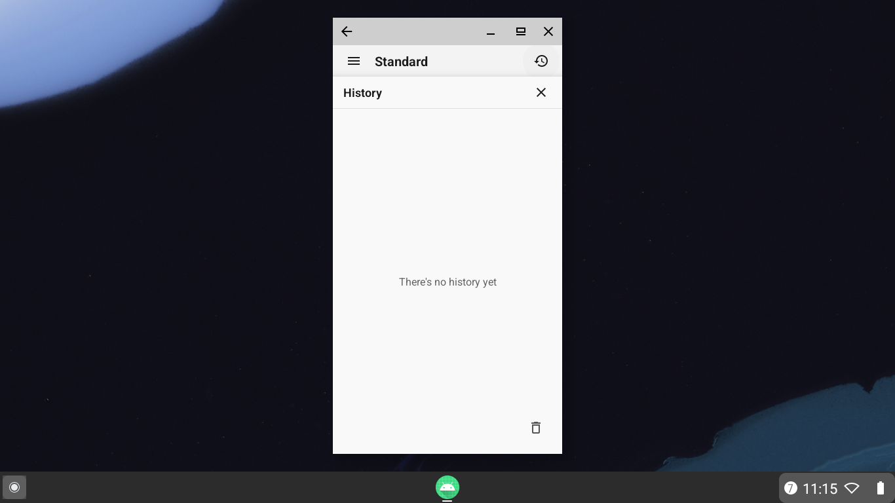
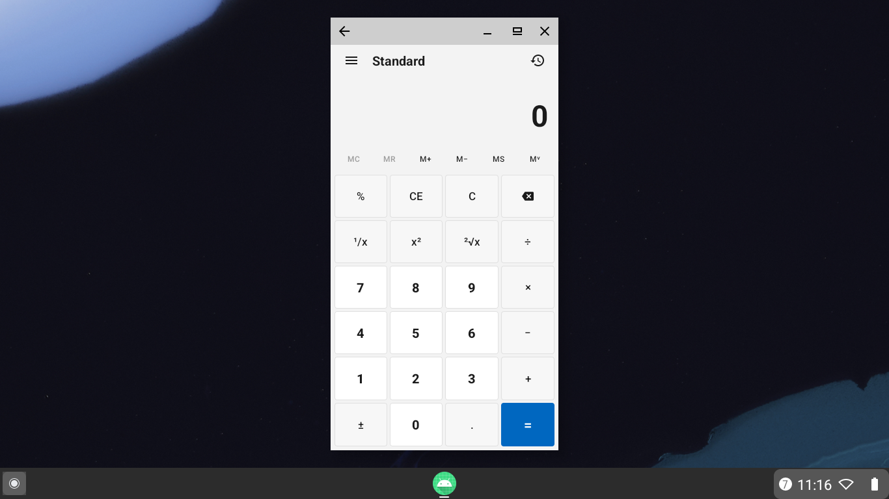
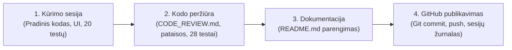

# MIPT Praktikos Darbas Nr. 3: Android Skaičiuotuvas (MiptCalculator)

> **MIF MIPT praktikos darbo Nr. 3 vietinė Android skaičiuotuvo programėlė, sukurta bendradarbiaujant su AI.**  
> Ši programėlė atkartoja standartinio „Windows Calculator“ skaičiuotuvo funkcionalumą mobiliajame telefone: palaiko binarines ir vienanares aritmetines operacijas, išmanų procentų skaičiavimą, skaičiavimų istoriją, atminties valdymą (`MC`, `MR`, `M+`, `M−`, `MS`, `M˅`), lietuvių bei anglų kalbas su atitinkamu dešimtainiu skirtuku (`,` arba `.`) ir automatinį prisitaikymą prie ekrano orientacijos (portretas / peizažas).

---

## Ekrano nuotraukos

| Portreto režimas (Standartinis) | Peizažo režimas (Padalintas ekranas) |
| :---: | :---: |
|  |  |

| Istorijos skydelis (Portretas) | Atminties peržiūra (`M˅`) |
| :---: | :---: |
|  |  |

---

## 1. Pavadinimas ir paskirtis

* **Pilnas pavadinimas:** MIPT Praktikos Darbas Nr. 3 – Android Skaičiuotuvas (`lt.mif.miptcalculator`)
* **Paskirtis:** Sukurti šiuolaikišką, ergonomišką, patikimą ir griežtai matematiškai tikslią Android skaičiuotuvo programėlę, paremtą **MVVM** (Model-View-ViewModel) architektūra ir savarankišku skaičiavimo varikliu (`CalculatorEngine`) be trečiųjų šalių matematinių išraiškų bibliotekų.
* **Kūrimo metodas:** Pilnavertis programinės įrangos inžinerijos procesas, atliktas naudojant pažangius AI modelius atskirose sesijose (kūrimas, nepriklausoma kodo peržiūra ir regresiniai testai, dokumentavimas, GitHub publikavimas).

---

## 2. Paleidimas ir aplinkos reikalavimai

Projekto `compileSdk` ir `targetSdk` yra 37; mažiausia palaikoma Android API versija – 24.

### Reikalingos priemonės
* **Java:** programėlės Java suderinamumas nustatytas į 17. Gradle paleidimo JVM projekte atskirai nurodyta kaip **Java 25** faile `gradle/gradle-daemon-jvm.properties` (`toolchainVersion=25`); pasirūpinkite, kad šis JDK būtų pasiekiamas arba galėtų būti parsiųstas pagal projekto konfigūraciją.
* **Android Studio:** versija, palaikanti projekte naudojamus Android Gradle Plugin 9.4.1, Gradle 9.6.0 ir SDK 37.
* **Android SDK:**
  * `minSdk`: **24** (Android 7.0 Nougat ar naujesnė)
  * `compileSdk`: **37**
  * `targetSdk`: **37**
* **Gradle Wrapper:** Versija **9.6.0** (įtraukta projekte per `gradlew` / `gradlew.bat`).
* **Android Gradle Plugin (AGP):** Versija **9.4.1**.
* **Kotlin:** Versija **2.2.10**.
* **Įrenginys:** Android emuliatorius (AVD) arba fizinis įrenginys su Android 7.0+ (API 24+).

### Žingsniai paleidimui per Android Studio
1. **Projekto atidarymas:**
   * Paleiskite „Android Studio“.
   * Meniu pasirinkite **File -> Open...** ir nurodykite atsisiųsto projekto šakninį aplanką, kuriame yra `settings.gradle.kts` (klonuojant šią saugyklą jis paprastai vadinasi `CalculatorVibe`).
2. **Gradle sinchronizavimas:**
   * Atidarius projektą, „Android Studio“ automatiškai pradės sinchronizavimą. Jei ne, viršutiniame dešiniajame kampe paspauskite **Sync Project with Gradle Files**.
    * Patikrinkite **Settings -> Build, Execution, Deployment -> Build Tools -> Gradle -> Gradle JDK**. Šiame projekte Gradle JVM kriterijus nurodo Java 25 faile `gradle/gradle-daemon-jvm.properties`; Java 17 yra programėlės kodo suderinamumo lygis.
3. **Vienetinių testų paleidimas:**
   * Prieš paleidžiant programėlę rekomenduojama įvykdyti automatinius testus:
     * Paspauskite dešiniuoju pelės klavišu ant `app/src/test/java` aplanko ir pasirinkite **Run 'Tests in 'engine''**, arba
     * Terminale įvykdykite:
       ```powershell
       ./gradlew.bat testDebugUnitTest
       ```
       *(Linux / macOS aplinkoje: `./gradlew testDebugUnitTest`)*
4. **Programėlės surinkimas ir paleidimas:**
   * Įrankių juostoje pasirinkite paleidimo modulį `app` ir tikslinį įrenginį / emuliatorių.
   * Paspauskite mygtuką **Run** (žalias trikampis) arba klavišų kombinaciją `Shift + F10`.
   * Programėlės APK failą taip pat galima surinkti per komandinę eilutę:
     ```powershell
     ./gradlew.bat assembleDebug
     ```
     Sugeneruotas failas bus patalpintas: `app/build/outputs/apk/debug/app-debug.apk`.
     Jį įdiegti į prijungtą įrenginį galima per ADB:
     ```powershell
     adb install -r app/build/outputs/apk/debug/app-debug.apk
     ```

---

Linux ir macOS aplinkoje po atsisiuntimo per GitHub failų įkėlimo sąsają, prieš vykdydami `./gradlew`, prireikus suteikite paleidimo teisę: `chmod +x gradlew`.

## 3. Naudojimas ir funkcionalumas

Programėlė tiksliai atitinka tradicinio stalinio/standartinio skaičiuotuvo darbo principus.

### 3.1. Aritmetinės binarinės operacijos
* **Sudėtis (`+`), Atimtis (`−`), Daugyba (`×`), Dalyba (`÷`):**
  * Įvedamas pirmasis skaičius, paspaudžiamas operatorius, įvedamas antrasis skaičius ir spaudžiama `=`.
  * Ekrano viršuje rodomas pilnas reiškinys (pvz., `15 × 4 =`), o pagrindiniame ekrane – rezultatas (`60`).

### 3.2. Vienanarės (Unary) operacijos
Vienanarės operacijos apskaičiuojamos akimirksniu esamai ekrano reikšmei ir gali būti naudojamos tiek savarankiškai, tiek grandinės viduje:
* **Kvadratinė šaknis (`√x`):** traukia šaknį iš teigiamo skaičiaus (pvz., `9 √x` -> `3`, viršuje `√(9)`).
* **Kėlimas kvadratu (`x²`):** pakelia esamą skaičių kvadratu (pvz., `5 x²` -> `25`, viršuje `sqr(5)`).
* **Atvirkštinė reikšmė (`1/x`):** padalija 1 iš esamo skaičiaus (pvz., `8 1/x` -> `0,125`, viršuje `1/(8)`).

### 3.3. Procentų skaičiavimas (`%`)
Procentų mygtukas veikia kontekstiškai, priklausomai nuo laukiančio operatoriaus:
* **Priedas / Antkainis (`+`):** `A + B %` apskaičiuoja $B\%$ nuo $A$, t. y. $A \times (B / 100)$.
  * *Pavyzdys:* `200 + 10 %` -> ekrane rodoma `20` (viršuje `200 + 20`), paspaudus `=` rezultatas `220`.
* **Nuolaida (`−`):** `A − B %` apskaičiuoja $B\%$ nuolaidą nuo $A$.
  * *Pavyzdys:* `200 − 10 %` -> ekrane rodoma `20`, paspaudus `=` rezultatas `180`.
* **Daugyba (`×`):** `A × B %` paverčia $B\%$ santykiu $B / 100$.
  * *Pavyzdys:* `200 × 10 %` -> ekrane rodoma `0,1`, paspaudus `=` rezultatas `20`.
* **Dalyba (`÷`):** `A ÷ B %`.
  * *Pavyzdys:* `200 ÷ 10 %` -> ekrane rodoma `0,1`, paspaudus `=` rezultatas `2000`.
* **Savarankiškas procentas:** įvedus skaičių ir iškart paspaudus `%` (pvz., `10 %`), reikšmė paverčiama į santykį `0,1`.

### 3.4. Ženklo keitimas (`±`) ir trynimas (`⌫`)
* **Ženklo keitimas (`±`):** apverčia dabartinio skaičiaus ženklą (iš teigiamo į neigiamą ir atvirkščiai). Įvedus `0`, ženklas nekeičiamas.
* **Paskutinio ženklo trynimas (Backspace `⌫`):** pašalina paskutinį įvestą skaitmenį arba dešimtainį skirtuką. Jei lieka vienintelis skaitmuo arba tik minusas, ekranas atstatomas į `0`. Po gauto rezultato ar naujos įvesties pradžioje trynimas yra blokuojamas.

### 3.5. Įvesties valymas: CE prieš C
| Mygtukas | Pavadinimas | Veikimo principas | Kada naudoti? |
| :--- | :--- | :--- | :--- |
| **CE** | *Clear Entry* (Valyti įvestį) | Išvalo **tik dabartinį renkamą skaičių** (nustato į `0`). Akumuliatorius, anksčiau pasirinktas veiksmas ir reiškinio pradžia **išlieka nepakitę**. | Kai suklystama renkant antrąjį (ar tolesnį) operandą ir nenorima prarasti viso skaičiavimo. |
| **C** | *Clear* (Valyti viską) | **Visiškai anuliuoja** visą skaičiuotuvo variklio būseną: išvalo ekraną, reiškinio eilutę, akumuliatorių, laukiančius operatorius ir pakartotinio `=` parametrus. | Kai norima pradėti visiškai naują skaičiavimą nuo nulio. |

### 3.6. Nuoseklus operacijų vykdymas (Immediate Execution)
Standartiniame skaičiuotuve netaikoma algebrinė daugybos ar dalybos viršenybė prieš sudėtį ir atimtį: veiksmai atliekami **nuosekliai iš kairės į dešinę**, paspaudus kiekvieną paskesnį binarinį operatorių.
* *Pavyzdys:* `2 + 3 × 4 = 20`.
  1. Įvedus `2 + 3` ir paspaudus `×`, variklis iškart atlieka tarpinį skaičiavimą: `2 + 3 = 5`.
  2. Ekrane parodomas tarpinis rezultatas `5`, o viršuje reiškinys `5 ×`.
  3. Įvedus `4` ir paspaudus `=`, atliekama `5 × 4 = 20`.

### 3.7. Pakartotinis lygybės (`=`) paspaudimas
Paspaudus `=` pakartotinai, skaičiuotuvas pakartoja paskutinį atliktą binarinį veiksmą su esamu rezultatu:
* *Pavyzdys:* `5 + 2 =` $\rightarrow$ ekrane `7`.
* Paspaudus `=` dar kartą $\rightarrow$ vykdoma `7 + 2 = 9`.
* Paspaudus `=` trečią kartą $\rightarrow$ vykdoma `9 + 2 = 11`.
* Pradėjus rinkti naują skaičių, ši pakartotinio veiksmo būsena automatiškai anuliuojama.

---

## 4. Skaičiavimų pavyzdžiai ir patikra

Visi žemiau pateikti pavyzdžiai yra patvirtinti automatizuotais vienetiniais testais:

| Scenarijus | Įvesties seka | Ekrano rezultatas | Viršutinis reiškinys | Pastabos |
| :--- | :--- | :--- | :--- | :--- |
| **Bazinė sudėtis** | `2` `+` `3` `=` | `5` | `2 + 3 =` | Paprastas binarinis veiksmas |
| **Tikslus dešimtainis** | `0.1` `+` `0.2` `=` | `0,3` *(LT)* / `0.3` *(EN)* | `0.1 + 0.2 =` | `BigDecimal` be IEEE 754 paklaidų |
| **Atimtis su trupmena** | `50` `−` `18.5` `=` | `31,5` | `50 − 18.5 =` | Tikslus trupmeninis rezultatas |
| **Dalyba** | `15` `÷` `4` `=` | `3,75` | `15 ÷ 4 =` | Tiksli dešimtainė trupmena |
| **Procentų antkainis** | `200` `+` `10` `%` `=` | `220` | `200 + 20 =` | `%` sugeneruoja `20`, `=` sudeda |
| **Procentų nuolaida** | `200` `−` `10` `%` `=` | `180` | `200 − 20 =` | `%` sugeneruoja `20`, `=` atima |
| **Procentų daugyba** | `200` `×` `10` `%` `=` | `20` | `200 × 0.1 =` | `10%` virsta `0.1` |
| **Atskiras procentas** | `10` `%` | `0,1` | `0.1` | Standalone procentas |
| **Kvadratinė šaknis** | `9` `√x` | `3` | `√(9)` | Vienanarė operacija |
| **Kėlimas kvadratu** | `5` `x²` | `25` | `sqr(5)` | Vienanarė operacija |
| **Atvirkštinė reikšmė**| `8` `1/x` | `0,125` | `1/(8)` | Vienanarė operacija |
| **Nuosekli grandinė** | `2` `+` `3` `×` `4` `=` | `20` | `5 × 4 =` | Tarpinis veiksmas ties `×` |
| **Grandinė su šaknimi**| `4` `+` `9` `√x` `+` `5` `=` | `12` | `7 + 5 =` | `4 + √(9) = 7`, tada `7 + 5 = 12` |
| **Grandinė su procentu**| `200` `+` `10` `%` `+` `5` `=` | `225` | `220 + 5 =` | `200 + 20 = 220`, tada `220 + 5 = 225` |
| **Operatoriaus keitimas**| `5` `+` `−` `×` `3` `=` | `15` | `5 × 3 =` | Galioja paskutinis pasirinktas `×` |
| **Pakartotinis lygybė** | `5` `+` `2` `=` `=` `=` | `11` | `9 + 2 =` | Rezultatai paeiliui: `7`, `9`, `11` |

---

## 5. Istorija ir atminties funkcijos

### 5.1. Skaičiavimų istorija (History)
* **Kaip atidaryti:**
  * **Portreto režime:** viršutinėje įrankių juostoje paspauskite istorijos piktogramą (laikroduką). Iš apačios atsidarys slenkantis istorijos sąrašas (`historyPanel`).
  * **Peizažo režime:** atskirai atidaryti nereikia – skaičiavimų istorija yra nuolat matoma dešinėje ekrano pusėje (užima 35% pločio).
* **Kaip panaudoti ankstesnį rezultatą:**
  * Paspauskite ant bet kurio istorijoje esančio įrašo. Jo apskaičiuota galutinė reikšmė bus akimirksniu įkelta į skaičiuotuvo ekraną kaip dabartinis operandas, o reiškinio eilutėje atvaizduota atitinkama išraiška. Tai leidžia sklandžiai tęsti grandininius skaičiavimus.
* **Kaip uždaryti:**
  * Paspauskite kryželio mygtuką `✕` viršutiniame dešiniajame istorijos kampe arba paspauskite įrenginio sistemos mygtuką **Back** (arba atlikite grįžimo gestą).
* **Kaip išvalyti:**
  * Paspauskite šiukšliadėžės mygtuką istorijos skydelio apačioje. Visa istorija bus išvalyta, o ekrane pasirodys pranešimas *„Istorijos dar nėra“* (*„There's no history yet“*).
* **Gyvavimo trukmė (Persistency):**
  * Istorija saugoma `CalculatorViewModel` atmintyje programėlės veikimo sesijos metu.
  * Ji pilnai išlieka sukiojant ekraną tarp portreto ir peizažo režimų.
  * Istorija nėra rašoma į nuolatinę disko saugyklą (SQLite/Room), todėl visiškai užvėrus programėlę ar OS sunaikinus procesą, istorija pradedama iš naujo.

### 5.2. Atminties valdymas (Memory Bar)
Virš skaičių klaviatūros integruota greitosios atminties juosta:
* **`MC` (Memory Clear):** išvalo atmintyje saugomą reikšmę. Kai atmintis tuščia, mygtukas tampa neaktyvus (papilkėjęs).
* **`MR` (Memory Recall):** iškviečia atmintyje esantį skaičių tiesiai į ekraną. Mygtukas aktyvus tik tuomet, kai atmintyje yra reikšmė.
* **`M+` (Memory Add):** prideda dabartinę ekrano reikšmę prie atmintyje esančio skaičiaus (jei atmintis buvo tuščia, tiesiog išsaugo).
* **`M−` (Memory Subtract):** atima dabartinę ekrano reikšmę iš atmintyje esančio skaičiaus.
* **`MS` (Memory Store):** įrašo dabartinę ekrano reikšmę į atmintį (perrašo bet kokį ankstesnį įrašą). Mygtukai `MC` ir `MR` iškart tampa aktyvūs.
* **`M˅` (Memory View):** atidaro modalinį dialogo langą, kuriame pateikiama šiuo metu atmintyje saugoma reikšmė arba pranešimas *„Atmintyje nieko nėra“*.

---

## 6. Kalbos, dešimtainis skirtukas ir ekrano režimai

### 6.1. Lokalizacija (LT / EN)
Programėlėje įdiegtas pilnas dvikalbystės palaikymas pagal įrenginio sistemos kalbą:
* **Lietuvių kalba (`res/values/strings.xml` – numatytoji):** visi mygtukai, prieinamumo aprašai (`contentDescription`), pranešimai ir klaidų tekstai pateikiami taisyklinga lietuvių kalba.
* **Anglų kalba (`res/values-en/strings.xml`):** pasikeitus sistemos kalbai į anglų ar bet kurią kitą nelietuvišką kalbą, sąsaja automatiškai persijungia į anglų kalbą.

### 6.2. Dešimtainis skirtukas
Dešimtainis skirtukas prisitaiko prie aktyvios lokalės:
* Lietuviškoje lokalėje dešimtainis klavišas rodo kablelį (`,`), o skaičiai formatuojami su kableliu (pvz., `0,5`).
* Angliškoje lokalėje naudojamas taškas (`.`) (pvz., `0.5`).
* Skirtukas dinamiškai atvaizduojamas tiek pagrindiniame ekrane, tiek viršutinėje reiškinio eilutėje ir istorijos įrašuose.

### 6.3. Ekrano režimai ir būsenos išsaugojimas
* **Portreto režimas (`layout/activity_main.xml`):**
  * Klasikinis vertikalus išdėstymas, optimizuotas valdymui viena ranka.
  * Istorija pasiekiama išskleidžiamame persidengiančiame skydelyje.
* **Peizažo režimas (`layout-land/activity_main.xml`):**
  * Padalintas ekranas (Split-Screen): **65%** ekrano kairėje skirta skaičiuotuvo ekranui ir klaviatūrai, o **35%** dešinėje – nuolat rodomai istorijai.
  * Viršutinis istorijos mygtukas peizaže automatiškai paslepiamas, kad netrukdytų.
* **Būsenos išsaugojimas pasukus ekraną:**
  * Dėl `CalculatorViewModel` panaudojimo, vartotojui pasukus ekraną bet kurioje skaičiavimo stadijoje, **visi duomenys išlieka**: dabartinė įvestis, laukiantis operatorius, akumuliatorius, atminties reikšmė ir visi atlikti istoriniai įrašai.

---

## 7. Klaidų valdymas ir atsistatymas

Programėlė apsaugota nuo bet kokių netikėtų lūžimų, susijusių su matematinėmis klaidomis:

| Klaida | Priežastis | Rodomas pranešimas (LT) | Rodomas pranešimas (EN) |
| :--- | :--- | :--- | :--- |
| **Dalyba iš nulio** | Dalyba iš `0` (pvz., `10 ÷ 0 =` arba `1/0`) | `Negalima dalyti iš nulio` | `Cannot divide by zero` |
| **Neleistina įvestis**| Šaknies traukimas iš neigiamo skaičiaus (pvz., `-9 √x`) | `Neleistina įvestis` | `Invalid input` |
| **Perpilda** | Reikšmė viršija leistinas skaičiavimo ribas | `Perpilda` | `Overflow` |

### Darbo tęsimas po klaidos
* Įvykus klaidai, skaičiuotuvas užblokuoja tolesnį neteisingo rezultato skaičiavimą ir neįtraukia klaidos į istoriją.
* **Atsistatymas:**
  1. Paspaudus **bet kurį skaitmenį** (`0`–`9`) arba **dešimtainį skirtuką**, klaidos būsena automatiškai panaikinama ir pradedamas naujas skaičiavimas.
  2. Paspaudus **`C`**, **`CE`** arba **`⌫` (Backspace)**, klaida iškart anuliuojama ir ekranas paruošiamas naujam darbui.

---

## 8. Techninė architektūra ir projekto struktūra

### 8.1. Savarankiškas `CalculatorEngine` ir `BigDecimal`
* Variklis suprojektuotas kaip **gryna Kotlin klasė** (`CalculatorEngine.kt`), neturinti jokių priklausomybių nuo `android.*` paketų. Tai leidžia atlikti žaibiškus vienetinius testus tiesiogiai kompiuteryje (ant JVM), nenaudojant lėtų emuliatorių.
* Visiems skaičiavimams naudojama `java.math.BigDecimal` su `MathContext.DECIMAL64` (16 reikšminių skaitmenų) ir apvalinimo taisykle `RoundingMode.HALF_EVEN`.
* Kvadratinės šaknies skaičiavimui (`computeSqrt`) taikomas didelio tikslumo **Niutono-Rapsono (Babiloniečių)** algoritmas su `BigDecimal`, užtikrinantis reikšminį tikslumą be konvertavimo į ribotą `Double`.

### 8.2. Pagrindinių projekto failų paskirtis
```text
MiptCalculator/
├── app/
│   ├── build.gradle.kts                # Modulio priklausomybės, SDK 37, Java 17, ViewBinding
│   └── src/
│       ├── main/
│       │   ├── AndroidManifest.xml     # Programėlės manifestas
│       │   ├── java/lt/mif/miptcalculator/
│       │   │   ├── engine/
│       │   │   │   ├── CalculatorEngine.kt   # Pagrindinė skaičiavimo logika, būsenos mašina
│       │   │   │   ├── CalculatorModels.kt   # Duomenų klasės: Operator, HistoryItem, klaidos
│       │   │   │   └── MemoryManager.kt      # Greitosios atminties saugykla (MC, MR, M+, M-, MS)
│       │   │   ├── viewmodel/
│       │   │   │   └── CalculatorViewModel.kt # MVVM LiveData sluoksnis, susiejantis UI su varikliu
│       │   │   └── ui/
│       │   │       ├── MainActivity.kt       # Pagrindinis Activity, mygtukai, orientacija, dialogai
│       │   │       └── HistoryAdapter.kt     # RecyclerView adapteris skaičiavimų istorijai
│       │   └── res/
│       │       ├── layout/
│       │       │   ├── activity_main.xml     # Portreto režimo maketas
│       │       │   └── item_history.xml      # Istorijos vieno įrašo maketas
│       │       ├── layout-land/
│       │       │   └── activity_main.xml     # Peizažo režimo maketas (Split-Screen 65%/35%)
│       │       ├── values/
│       │       │   ├── strings.xml           # Lietuviški tekstai ir lokalizacija
│       │       │   ├── colors.xml            # Spalvų paletė
│       │       │   └── themes.xml            # Material3 stiliai
│       │       └── values-en/
│       │           └── strings.xml           # Angliški tekstai ir lokalizacija
│       └── test/java/lt/mif/miptcalculator/engine/
│           └── CalculatorEngineTest.kt       # 28 automatizuoti JUnit vienetiniai testai
├── build.gradle.kts                    # Projekto šakninis Gradle skriptas
├── settings.gradle.kts                 # Repozitorijų ir modulių konfigūracija
├── gradle/libs.versions.toml           # Versijų katalogas (Gradle Version Catalog)
├── CODE_REVIEW.md                      # Kodo peržiūros ataskaita (radiniai, pataisos, patikra)
└── README.md                           # Pagrindinė projekto dokumentacija
```

---

## 9. Patikros, kodo peržiūra ir apribojimai

### 9.1. Kodo peržiūros rezultatai ([CODE_REVIEW.md](CODE_REVIEW.md))
Prieš dokumentavimo etapą projektui buvo atlikta griežta ir nepriklausoma kodo peržiūra. Jos metu buvo identifikuotos ir ištaisytos šios esminės problemos:
1. **Radinys R1 (Kritinis – Crash):** Programėlės lūžimas (`NullPointerException`) paspaudus bet kurį binarinį operatorių iškart po lygybės (`=`). Variklyje pataisytas `setOperator`, užtikrinant sklandų skaičiavimo tęsimą.
2. **Radinys R2 (Aukštas – Silent Data Loss):** Operando praradimas grandinėse po procentų (`%`), vienanarių operacijų (`√x`, `x²`, `1/x`) ir `MR`. Variklis klaidingai laikydavo šią būseną operatoriaus pakeitimu. Įvesta vėliavėlė `canReplaceOperator`, išsprendusi problemą.
3. **Papildomi patobulinimai:** Ištaisytas pakartotinio `=` būsenos anuliavimas įvedus naują skaičių (R3), išvalytas viršutinis reiškinys pradedant naują skaičiavimą (R4), lokalizuotas `btnMenu` aprašas (R5).

### 9.2. Faktiniai patikros rezultatai
* **Vienetiniai testai (JUnit):**
  * Paleista komanda: `./gradlew.bat testDebugUnitTest`
  * Rezultatas: **Išlaikyti visi 28 testai iš 28** (pradiniai 20 testų + 8 nauji regresiniai testai, 0 nesėkmių, 0 klaidų).
* **Projekto surinkimas (Build):**
  * Paleista komanda: `./gradlew.bat assembleDebug`
  * Rezultatas: **BUILD SUCCESSFUL**.
* **Patikra emuliatoriuje:**
  * Sėkmingai įdiegta ir išbandyta Android emuliatoriuje `emulator-5554` (fiksuoti realūs ekrano kadrai).

### 9.3. Žinomi apribojimai
* **Proceso sunaikinimas fone (Process Death):** `CalculatorViewModel` naudoja standartinę atminties būseną be `SavedStateHandle`. Įprasto ekrano pasukimo metu visa būsena išlieka 100%, tačiau OS nutraukus programėlės procesą fone, programėlė startuotų iš naujo.
* **Automatiniai UI testai (Espresso):** Visi 28 testai dengia verslo logiką ir skaičiavimo variklį; automatiniai instrumentiniai vartotojo sąsajos testai šiam darbui nebuvo kuriami (sąsaja patikrinta rankiniu būdu emuliatoriuje).

---

## 10. AI darbo eiga ir sesijų struktūra

Projektas buvo įgyvendintas nuosekliai per 4 atskiras specializuotas AI sesijas:



1. **1 sesija – Kūrimas (Implementation):**
   * Sukurtas projekto karkasas, MVVM struktūra, `CalculatorEngine`, `MemoryManager`, vartotojo sąsajos maketai (portretas ir peizažas), dvikalbystė ir pirmieji 20 vienetinių testų.
2. **2 sesija – Kodo peržiūra (Code Review):**
   * Nepriklausomas kodo auditas. Identifikuotas ir ištaisytas kritinis lūžimas po `=` bei operando praradimas grandinėse. Pridėti 8 regresiniai testai (iš viso 28 testai). Parengta išsami ataskaita: [CODE_REVIEW.md](CODE_REVIEW.md).
3. **3 sesija – Vartotojo dokumentacija:**
   * Parengtas galutinis, išsamus lietuviškas `README.md` failas, atitinkantis realią programėlės architektūrą, tikrus testų rezultatus ir faktinius ekrano kadrus.
4. **4 sesija – GitHub publikavimas:**
   * Galutinis kodo patvirtinimas (commit), projekto įkėlimas į nuotolinę GitHub repozitoriją ir pilno AI sesijų žurnalo pridėjimas: [SESSION_LOG.md](SESSION_LOG.md).

---

## Licencija ir autoriai

* **Autorius:** Rokas / MIF VU (MIPT praktikos darbas Nr. 3)
* **Bendradarbis:** Google DeepMind Advanced Agentic Coding AI (Antigravity)
* **Data:** 2026 m. lapkričio mėn.
